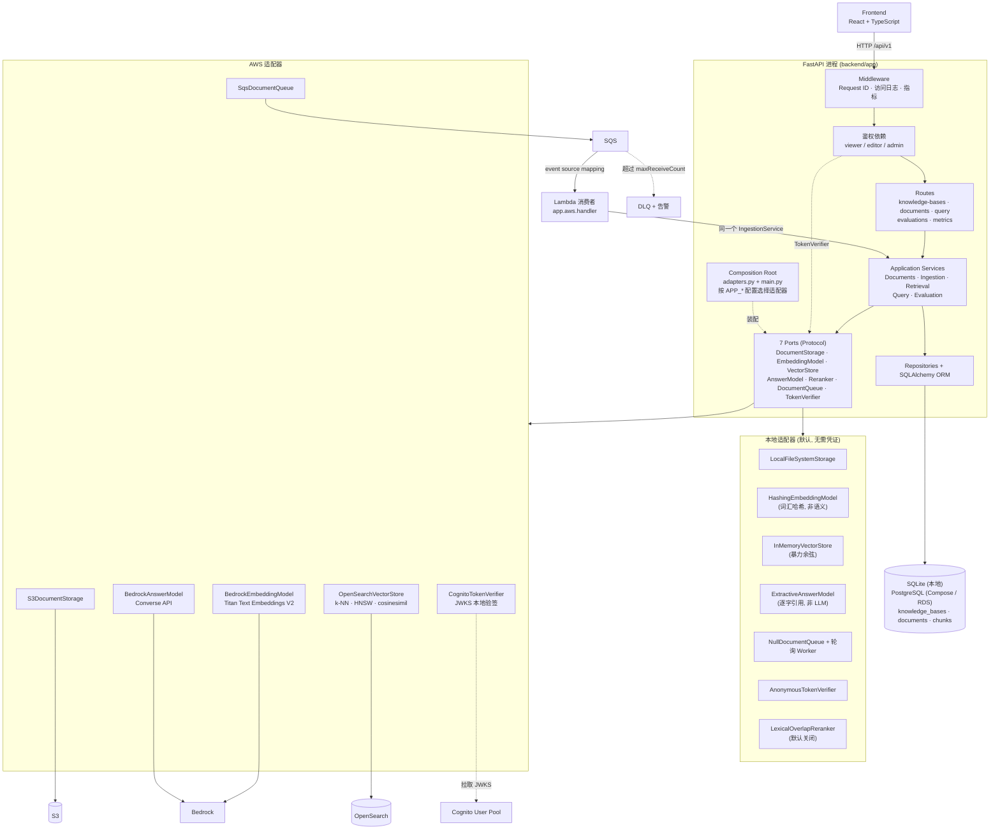
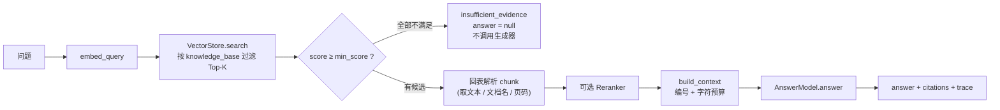
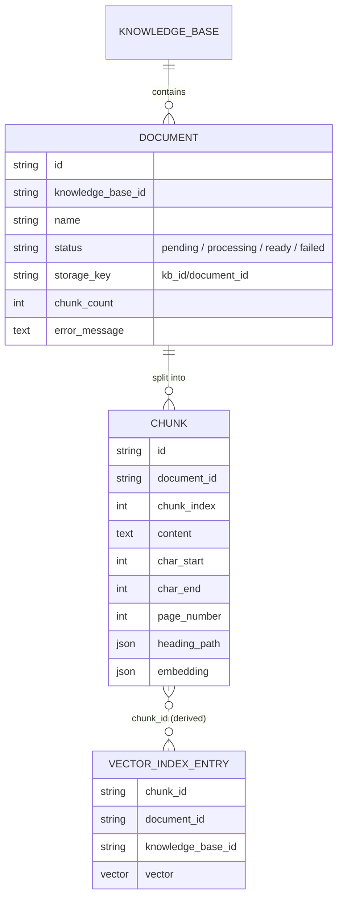
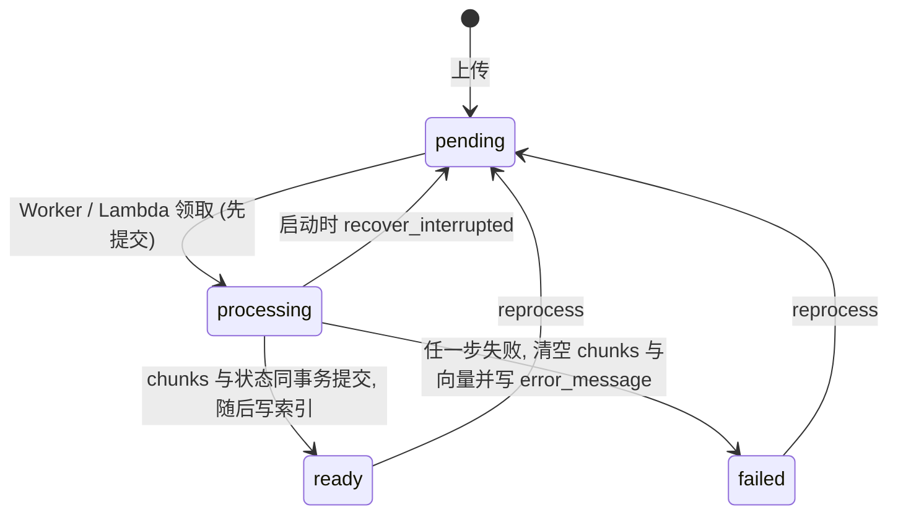
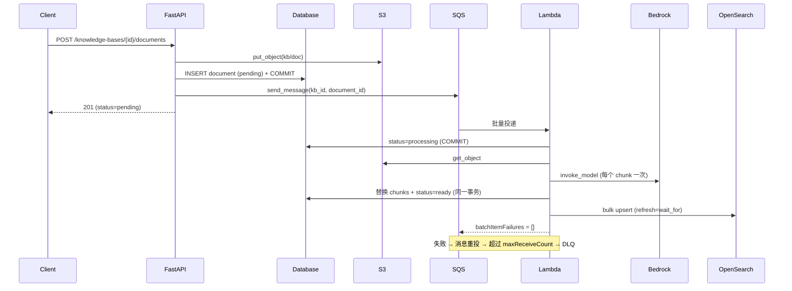
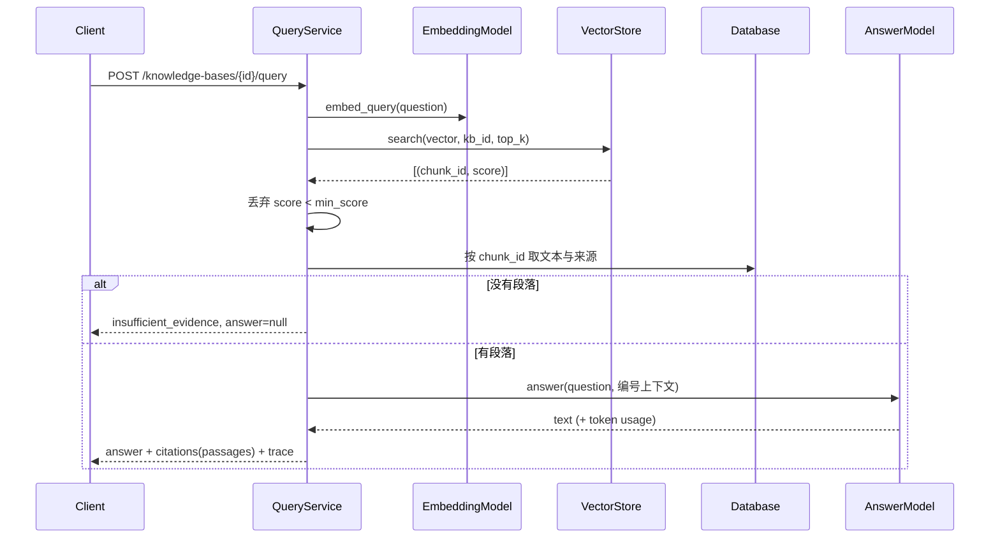

# AWS Enterprise RAG Platform

**企业知识库 RAG 问答平台｜Enterprise Knowledge-Base RAG Backend**

围绕企业自有文档（运维手册、安全策略、流程规范）构建的检索增强问答后端：文档摄取 → 向量检索 → 阈值过滤 → 带引用生成。检索结果未达到相关性阈值时返回 `insufficient_evidence`，不进入生成。

`Python 3.12` · `FastAPI` · `SQLAlchemy 2.0` · `PostgreSQL` · `OpenSearch k-NN` · `Amazon Bedrock` · `S3` · `SQS` · `Lambda` · `Cognito` · `Terraform` · `Docker` · `React / TypeScript`

---

## 1. Project Overview｜项目概述

### 1.1 解决什么问题

企业知识分散在手册、制度和复盘文档里。员工提问时的难点往往不是"搜不到"，而是：命中的段落是否真的回答了问题；答案出自哪份文档、哪一段；知识库没有答案时系统会不会编一个。本项目把这些做成可测试的后端行为，而不只依赖提示词：

| 问题 | 本项目的做法 |
| --- | --- |
| 相关性无保证 | 检索后用 `min_score` 阈值过滤，阈值定义在余弦尺度上 |
| 答案不可追溯 | 引用 = 实际放入上下文的 chunk，带文档名、段落序号、页码、标题路径、分数 |
| 无依据生成 | 没有候选达到阈值时不调用生成器，直接返回 `insufficient_evidence`；有候选时，提示词限定只依据编号段落作答 |
| 本地与云上两套代码 | 7 类端口（Protocol）+ 本地 / AWS 适配器，在组装根按配置切换 |
| 摄取失败难恢复 | `pending → processing → ready / failed` 状态机，重摄取幂等，失败时清理段落与向量 |

### 1.2 项目背景

作者在参与 AWS 校企合作项目的过程中接触了 S3、Bedrock、Lambda 等云服务，随后把这些经验用于一个**独立设计与实现**的个人项目：企业知识库问答后端。架构、代码、测试和基础设施描述均为本仓库独立完成，以仓库内的代码、测试和文档为准。

### 1.3 验证范围

全文使用以下说明，不再逐处重复：

| 标记 | 含义 |
| --- | --- |
| **已运行** | 在本机真实执行：SQLite + 真实 HTTP（`TestClient`）、`pytest`、`ruff` |
| **桩测试** | AWS 适配器的请求 / 响应映射由注入的桩客户端覆盖 |
| **项目记录** | 来自 [docs/implementation-report.md](./docs/implementation-report.md) 的记录，如 Terraform `validate` |
| **云端** | 尚未向真实 AWS 账号部署，也未对真实 S3 / Bedrock / OpenSearch / SQS / Cognito 发起过请求 |

一句话：**本地全链路可运行；AWS 适配层与 Terraform 已实现，并通过桩测试和静态校验；云端部署是下一步。**

---

## 2. Highlights｜项目亮点

| 亮点 | 实现要点 |
| --- | --- |
| **Ports & Adapters** | 7 个 `typing.Protocol` 端口：`DocumentStorage`、`EmbeddingModel`、`VectorStore`、`AnswerModel`、`Reranker`、`DocumentQueue`、`TokenVerifier`；选择逻辑集中在 `adapters.py` + `main.py` |
| **完整 RAG Pipeline** | 解析 → 结构保留切分（1200 字符窗口 / 200 重叠）→ Embedding → Top-K → 阈值 → 上下文预算 → 生成 → 引用 |
| **引用溯源 + 证据不足拒答** | 引用来自放入上下文的 chunk，不解析模型输出；无候选达到阈值时不调用生成器；`trace` 解释为什么拒答 |
| **异步摄取状态机** | `pending → processing → ready / failed`；chunk 与 `ready` 同事务提交；`reprocess`、启动恢复、整文档幂等替换 |
| **SQS / Lambda / DLQ** | `SqsDocumentQueue` 发布；Lambda handler 返回 `batchItemFailures`；Terraform 配置 `maxReceiveCount=3` 的 DLQ 与告警 |
| **AWS 服务适配** | S3、Bedrock Titan Embedding、Bedrock Converse、OpenSearch k-NN（HNSW）、SQS、Cognito 六类适配器 |
| **JWT / RBAC** | Cognito JWKS 本地验签（仅 RS256，校验 issuer / client / token_use）；三级有序角色；路由器层默认要求 `viewer` |
| **RAG Evaluation** | `POST /api/v1/evaluations`：recall@k / MRR / nDCG / citation precision & recall / 拒答率 |
| **工程化** | 547 个后端测试、95 个前端测试、Ruff、`tsc`、Terraform 九模块、Docker / Compose、结构化日志、Request ID |

---

## 3. Architecture｜架构设计

### 3.1 系统架构



- 业务层只依赖端口，不 `import boto3`，也不判断运行环境；
- 向量索引只存 id 与向量，**chunk 文本只在数据库**，检索结果回表解析；
- API 进程和 Lambda 消费者通过同一个 `build_ingestion_service(...)` 创建摄取服务。

### 3.2 端口与适配器

| 端口 | 职责 | 本地适配器（默认） | AWS 适配器 | 切换配置 |
| --- | --- | --- | --- | --- |
| `DocumentStorage` | 保存 / 读取 / 删除原始文档字节 | `LocalFileSystemStorage` | `S3DocumentStorage` | `APP_STORAGE_BACKEND` |
| `EmbeddingModel` | 文档与查询向量化（两个入口分开） | `HashingEmbeddingModel` | `BedrockEmbeddingModel` | `APP_EMBEDDING_PROVIDER` |
| `VectorStore` | upsert / delete_document / search / count | `InMemoryVectorStore` | `OpenSearchVectorStore` | `APP_VECTOR_STORE_BACKEND` |
| `AnswerModel` | 问题 + 上下文 → 答案 | `ExtractiveAnswerModel` | `BedrockAnswerModel` | `APP_GENERATION_PROVIDER` |
| `Reranker` | 二阶段重排 | `LexicalOverlapReranker`（默认关闭） | — | `APP_RERANK_ENABLED` |
| `DocumentQueue` | 发布摄取任务 | `NullDocumentQueue` | `SqsDocumentQueue` | `APP_QUEUE_BACKEND` |
| `TokenVerifier` | Bearer token → Principal | `AnonymousTokenVerifier` | `CognitoTokenVerifier` | `APP_AUTH_BACKEND` |

每个 AWS 适配器遵循三条约定：SDK 延迟导入（本地不装 boto3 也能运行）、接受注入的客户端（无账号即可测请求映射）、上游失败映射为 502 领域错误（`EMBEDDING_FAILED`、`VECTOR_STORE_ERROR`、`GENERATION_FAILED`、`STORAGE_ERROR`、`QUEUE_UNAVAILABLE`、`AUTH_UNAVAILABLE`）。

### 3.3 RAG Pipeline

**摄取（写路径）**

```mermaid
flowchart LR
    U["上传文件"] --> V["校验扩展名 / 大小"]
    V --> S["写入 DocumentStorage"]
    S --> P["插入 documents<br/>status=pending 并 COMMIT"]
    P --> Q["DocumentQueue.enqueue<br/>(仅 kb_id + document_id)"]
    Q --> W["本地: 轮询 Worker<br/>AWS: SQS → Lambda"]
    W --> PR["status=processing<br/>(先提交)"]
    PR --> PA["解析<br/>pdf / md / txt"]
    PA --> C["切分<br/>1200 字符 / 200 重叠"]
    C --> E["EmbeddingModel<br/>embed_documents"]
    E --> T["事务: 替换 chunks<br/>+ status=ready"]
    T --> I["VectorStore<br/>delete_document + upsert"]
```



**问答（读路径）**



---

## 4. Core Design｜核心技术设计

每节按 **业务场景 → 技术机制 → 设计价值** 组织。

### 4.1 Ports & Adapters

**业务场景**：开发、评审、CI 需要零依赖运行；部署时换成 S3 / Bedrock / OpenSearch / SQS / Cognito，且不改业务代码。

**技术机制**：端口是 `@runtime_checkable` 的 `Protocol`，定义在领域一侧（如 `app/rag/vector_store.py`）；适配器在 `app/aws/`、`app/rag/`、`app/repositories/`。选择逻辑集中在 `backend/app/adapters.py`：

```python
def build_embedder(settings: Settings) -> EmbeddingModel:
    """Return the embedding model the configuration asks for."""
    if settings.embedding_provider == "bedrock":
        return BedrockEmbeddingModel(
            dimensions=settings.embedding_dimensions,
            model_id=settings.bedrock_embedding_model_id,
            region=settings.bedrock_region,
        )
    return HashingEmbeddingModel(settings.embedding_dimensions)
```

`Settings`（`pydantic-settings`，`APP_` 前缀）在启动时校验：缺 bucket、缺 OpenSearch endpoint、basic auth 只给一半、`production` 环境使用 `auth_backend=none`，进程都会带明确错误退出，而不是等到第一次请求才失败。

**设计价值**：本地与 AWS 可以逐项切换（文档放 S3、Embedding 仍用本地）；适配器可注入客户端，请求映射无需 AWS 账号即可测试；向量维度只有 `APP_EMBEDDING_DIMENSIONS` 一个来源，同时决定 Embedding 请求和索引 mapping。

### 4.2 Document Ingestion Pipeline

**业务场景**：上传 PDF / Markdown / TXT，得到可检索、可引用的段落；上传请求不等待解析和 Embedding。

**技术机制**：

- **解析**（`ingestion/parsers.py`）：PDF 用 `pypdf` 按页产出 block（保留 `page_number`）；Markdown 按 ATX 标题切 block 并记录 `heading_path`；
- **切分**（`ingestion/chunking.py`）：按字符窗口（默认 1200，重叠 200），优先在 `\n\n`、`\n`、`. `、空格处断开，断点只在窗口后半段才被接受，避免出现过小的块；每块记录 `char_start / char_end / page_number / heading_path`；
- **落库顺序**（`services/ingestion.py`）：先提交 `processing`，再解析、切分、Embedding；chunk 替换和 `ready` 在**同一事务**提交；事务提交后再更新向量索引；索引写入失败则文档转为 `failed`，并清理 chunk 与向量。

```python
# services/ingestion.py（节选）
vectors = self._embedder.embed_documents([draft.content for draft in drafts])
records = self._store_chunks(document_id, knowledge_base_id, drafts, vectors)

# The index is updated only after the chunks are committed: a vector pointing
# at a row nobody can read would break citation resolution.
self._vector_store.delete_document(document_id)
self._vector_store.upsert(records)
```

**设计价值**：索引里的向量总能在数据库中找到对应 chunk，引用可以回查；索引是派生数据，进程在"提交 `ready`"与"写入索引"之间崩溃时，启动阶段的 `rebuild_vector_index` 会按库里保存的 embedding 补齐。

> 切分按字符而非模型 token 计数；句子边界目前只识别英文 `. `。

### 4.3 Embedding / Vector Retrieval

**业务场景**：把问题和段落放进同一向量空间做相似度检索。

**技术机制**：

- `EmbeddingModel` 把 `embed_documents` 与 `embed_query` 分成两个入口，非对称编码由适配器决定；
- **本地** `HashingEmbeddingModel`：词项哈希到固定桶数（默认 256 维），次线性 TF 权重，L2 归一化。它度量词汇重合而非语义，分词只匹配 `[a-z0-9]+`，用于离线运行和测试；
- **AWS** `BedrockEmbeddingModel`：调用 `amazon.titan-embed-text-v2:0`，每个 chunk 一次请求，发送并校验 `dimensions`，拒绝长度不符或含 NaN / Inf 的向量；
- **`OpenSearchVectorStore`**：`knn_vector` + HNSW + `cosinesimil`（托管域 `nmslib`，Serverless `faiss`）；按 `knowledge_base_id` 做 filter；写入使用 `refresh=wait_for`，bulk 部分失败视为失败。

```python
# aws/opensearch_vector_store.py（节选）
def _to_cosine(score: Any) -> float:
    """Convert an OpenSearch ``cosinesimil`` score back to a cosine similarity."""
    return 2.0 * float(score) - 1.0
```

**设计价值**：OpenSearch 的 `cosinesimil` 得分是 `(1 + cos) / 2`，本地返回 cosine。适配器在边界处换算，同一个 `min_score` 在两种后端含义一致，所以距离度量不做成配置项。

### 4.4 Evidence Filtering / Grounded Generation

**业务场景**：知识库没有相关内容时，不应让模型凭自身知识作答。

**技术机制**（`services/retrieval.py`、`services/query.py`、`rag/context.py`）：

1. 向量检索取 Top-K（启用 Reranker 时多取 `top_k × retrieval_candidate_multiplier` 个候选）；
2. 丢弃 `score < min_score` 的候选；
3. 回表解析 chunk，构造带编号和来源标签的上下文（默认 6000 字符预算，整段放入，不把一段话截成半句）；
4. 没有任何段落时返回 `insufficient_evidence`，**不调用 `AnswerModel`**；
5. 有段落时，提示词要求只依据编号段落作答、逐句标注 `[n]`、覆盖不到就说明知识库未覆盖；Bedrock 调用默认 `temperature=0`。

```python
# services/query.py（节选）
if not bundle.passages:
    # Nothing cleared the threshold, or the knowledge base holds nothing that is
    # ready. Reporting that is the point of the threshold: an unsupported answer
    # is worse than no answer.
    ...
    outcome=QueryOutcome.INSUFFICIENT_EVIDENCE, answer=None, citations=(), generation=None
```

**设计价值**：是否进入生成由检索阈值决定，不依赖模型是否"自觉"拒答；引用列表是放进上下文的 passage 本身，即使模型漏写 `[1]`，引用仍然指向真实存在的 chunk。阈值能否分开相关与不相关内容取决于 Embedding 质量（见 9.2），生成阶段则由提示词约束，没有生成后的事实核验。

### 4.5 Asynchronous Ingestion / Retry / DLQ

**业务场景**：多个 API 实例并行服务，摄取需要独立伸缩，失败要可重试、可观察。

**技术机制**：

- **本地**：`IngestionWorker` 线程轮询 `pending` 文档（`NullDocumentQueue` 丢弃消息）。不用 FastAPI `BackgroundTasks`，因为后台任务在请求事务提交前运行，读不到刚插入的行（ADR 0003）；
- **AWS**：上传接口先 `COMMIT`，再向 SQS 发布只含 `knowledge_base_id + document_id` 的版本化消息；Lambda 消费者调用同一个 `IngestionService.run`；
- **消息何时算完成**由文档状态决定（`services/ingestion_consumer.py`）：文档到达 `ready` 或 `failed` 才算完成；文档不存在、仍在 `processing`、消息体非法，都交回 SQS 重投；
- Lambda 返回 `batchItemFailures`，event source mapping 启用 `ReportBatchItemFailures`，只删除成功的消息；超过 `maxReceiveCount`（Terraform 默认 3）进入 DLQ，DLQ 非空触发告警。

```python
# aws/handler.py（节选）
return {
    "batchItemFailures": [
        {"itemIdentifier": message_id} for message_id in result.failed_message_ids
    ]
}
```

**设计价值**：摄取服务把失败写进文档而不是抛异常，所以"调用返回"不等于"工作完成"，只有看到终态才删消息。Terraform 变量校验要求 `ingestion_timeout_seconds < queue_visibility_timeout_seconds`（默认 300 < 900），避免函数仍在运行时消息被重投。

### 4.6 Authentication & Authorization

**业务场景**：本地零配置可用；部署后所有 `/api` 接口必须带有效 token，写操作按角色限制。

**技术机制**：

- `CognitoTokenVerifier`：拉取并缓存 JWKS（默认 1 小时），**只接受 RS256**，校验 `iss`、`exp / iat / sub`、`token_use ∈ {access, id}`，并手动校验 `client_id / aud`（Cognito access token 没有 `aud`）；未知 `kid` 触发限频刷新；JWKS 不可达返回 `502 AUTH_UNAVAILABLE`，不冒充 401；
- 角色来自 `cognito:groups`：`viewer < editor < admin`，高角色满足低要求；
- 路由器层默认依赖 `viewer`，新增路由默认受保护，写接口再声明 `EditorDep` / `AdminDep`；`production` 环境拒绝 `auth_backend=none`。

```python
# api/router.py（节选）
api_router = APIRouter(dependencies=[Depends(require_roles(VIEWER))])
```

| 角色 | 权限 |
| --- | --- |
| `viewer` | 读知识库 / 文档 / 段落 / 指标，提问 |
| `editor` | 创建知识库，上传、重摄取、删除文档 |
| `admin` | 删除知识库，运行评估 |

测试覆盖过期、错 issuer、错 client、refresh token、`alg=none`、HS256 混淆、篡改 payload、密钥轮换等情形（使用本地生成的 RSA 密钥和构造的 JWKS）。

### 4.7 Observability / Reliability

- **Request ID / 日志**：读取或生成 `X-Request-ID`，写入响应头、日志上下文和问答 `trace`；`structlog` 生产 JSON、本地 console，5xx 记录原因链；
- **健康检查与指标**：`/health`（存活）、`/health/ready`（检查数据库，只返回异常类型以免泄露连接串）；`/api/v1/metrics` 返回进程内计数器与延迟分位数，按路由模板打标，防止编造 ID 产生无限指标序列；
- **错误与恢复**：统一错误信封 `{request_id, error:{code, message, details}}`；重摄取整文档替换；启动时 `recover_interrupted()` 把崩溃遗留的 `processing` 放回 `pending`。

---

## 5. Data & RAG Flow｜数据与问答流程

### 5.1 数据关系



- `chunks` 是持久化的事实来源（含文本和 embedding）；向量索引是可重建的派生数据；
- Citation 通过 `chunk_id` 回到 `chunks`，再通过 `document_id` 回到文档，可用 `GET …/documents/{id}/chunks` 核对原文；
- 所有检索按 `knowledge_base_id` 过滤。

### 5.2 文档状态机



### 5.3 异步摄取时序（AWS 模式）



### 5.4 查询时序



### 5.5 引用示例

```json
{
  "marker": 1,
  "document_name": "encryption-policy.md",
  "chunk_id": "b1c2d3e4f5a60718293a4b5c6d7e8f90",
  "chunk_index": 2,
  "page_number": null,
  "heading_path": ["Encryption policy", "Credential rotation"],
  "score": 0.369274,
  "rerank_score": null,
  "snippet": "Credential rotation Database credentials rotate every ninety days…"
}
```

`trace` 同时返回 `candidates`、`above_threshold`、`used`、`min_score`、`missing_chunks` 和各阶段耗时，用来判断拒答原因：知识库没有相关内容，还是阈值挡掉了候选。

---

## 6. API Overview｜接口概览

前缀 `/api/v1`。除探针外所有接口至少需要 `viewer`（`auth_backend=none` 时本地全部放行）。完整接口见运行后的 `/docs`。

| 分类 | 方法与路径 | 最低角色 | 说明 |
| --- | --- | --- | --- |
| 知识库 | `POST /knowledge-bases` | editor | 创建 |
| | `GET /knowledge-bases` · `GET /knowledge-bases/{id}` | viewer | 列表 / 详情 |
| | `DELETE /knowledge-bases/{id}` | admin | 级联清理文档、段落、存储对象、向量 |
| 文档 | `POST /knowledge-bases/{id}/documents` | editor | multipart 上传，返回 `pending`；`.pdf` `.md` `.markdown` `.txt` |
| | `GET …/documents` · `GET …/documents/{doc_id}` | viewer | 列表 / 元数据与状态 |
| | `GET …/documents/{doc_id}/chunks` | viewer | 查看被索引的段落 |
| | `POST …/documents/{doc_id}/reprocess` | editor | 丢弃旧段落与向量，重新排队（`202`） |
| | `DELETE …/documents/{doc_id}` | editor | 删除文档、段落、向量与存储对象 |
| 问答 | `POST /knowledge-bases/{id}/query` | viewer | 请求 `question`、可选 `top_k`、`min_score`；返回 `outcome`、`answer`、`citations`、`trace` |
| 评估 | `POST /evaluations` | admin | 带标注数据集，同步运行并返回指标 |
| 运维 | `GET /metrics` | viewer | 进程内计数与延迟 |
| 探针 | `GET /`、`GET /health`、`GET /health/ready` | 公开 | 服务元数据、存活、就绪 |

错误响应统一为 `{"request_id": "...", "error": {"code": "...", "message": "...", "details": {}}}`，常见码：`401 UNAUTHENTICATED`、`403 FORBIDDEN`、`404 NOT_FOUND`、`413`、`415`、`422 INVALID_EVALUATION_DATASET`、`502`（上游失败）。

---

## 7. Tech Stack｜技术栈

| 分类 | 技术 |
| --- | --- |
| 后端 | Python 3.12、FastAPI、Uvicorn、Pydantic v2、pydantic-settings、structlog |
| 持久化 | SQLAlchemy 2.0（同步）；SQLite（本地默认）、PostgreSQL 16（Compose）/ RDS PostgreSQL（Terraform），驱动 `psycopg` |
| AI / RAG | 自实现 RAG 流水线（未使用 LangChain 等编排框架）；Embedding：本地哈希 / Bedrock Titan Text Embeddings V2；生成：本地提取式 / Bedrock Converse（默认 `amazon.nova-lite-v1:0`）；可选词汇重叠 Reranker |
| 文档解析 | `pypdf`（PDF）、自写 Markdown / TXT 结构解析 |
| 向量检索 | 进程内暴力余弦（本地）；OpenSearch k-NN（HNSW，`nmslib` / `faiss`） |
| AWS | S3、Bedrock、OpenSearch、SQS、Lambda（容器镜像）、Cognito、ECS Fargate、RDS、ALB、ECR、Secrets Manager、IAM、CloudWatch Alarms；SDK：`boto3`、`opensearch-py` |
| 安全 | Cognito（授权码 + PKCE）、`PyJWT[crypto]` 本地验签、三级 RBAC、`SecretStr`、Secrets Manager 注入数据库 URL |
| 前端 | React 19、React Router 7、TypeScript、Vite、Vitest + Testing Library |
| 基础设施 | Terraform ≥ 1.6（AWS provider ~> 5.60，九个模块）、多阶段 Dockerfile（含 `lambda` 阶段）、Docker Compose（PostgreSQL + API + nginx + 可选 OpenSearch profile） |
| 测试与质量 | pytest、Ruff、`tsc --noEmit`、`terraform validate / fmt` |

---

## 8. Quick Start｜运行与部署

以下命令除特别标注外，均在**仓库根目录**执行。

### 8.1 本地模式（无需云账号）

环境：Python 3.12；前端另需 Node.js 与 pnpm。

```bash
# 1. 创建 backend/.venv 并安装依赖（含 dev）
./scripts/bootstrap-backend.sh

# 2. 可选：复制配置模板（每个值都等于默认值）
cp backend/.env.example backend/.env

# 3. 启动后端（保持在 backend/ 目录运行，SQLite 与文档目录相对该目录创建）
#    → http://127.0.0.1:8000，OpenAPI: /docs
(cd backend && .venv/bin/python -m app)
```

默认组合：SQLite + 本地文件存储 + 哈希 Embedding + 内存向量索引 + 提取式回答 + 轮询 worker + 无认证。保持服务运行，**另开一个终端**，在仓库根目录：

```bash
BASE=http://127.0.0.1:8000/api/v1
parse_id() { python3 -c 'import json,sys; print(json.load(sys.stdin)["id"])'; }

curl -s http://127.0.0.1:8000/health/ready

# 创建知识库
KB_ID=$(curl -s -X POST "$BASE/knowledge-bases" \
  -H 'Content-Type: application/json' \
  -d '{"name": "platform-runbooks", "description": "Internal operations runbooks"}' | parse_id)

# 上传文档（返回 pending），再轮询状态直到 ready / failed
DOC_ID=$(curl -s -X POST "$BASE/knowledge-bases/$KB_ID/documents" \
  -F "file=@docs/deployment/aws.md" | parse_id)
curl -s "$BASE/knowledge-bases/$KB_ID/documents/$DOC_ID"

# 提问
curl -s -X POST "$BASE/knowledge-bases/$KB_ID/query" \
  -H 'Content-Type: application/json' \
  -d '{"question": "How often do database credentials rotate?"}'
```

前端（后端已启动）：

```bash
(cd frontend && pnpm install && pnpm dev)     # http://127.0.0.1:5173，/api 与 /health 代理到 :8000
```

> 本地哈希 Embedding 只理解 ASCII 字母数字词，适合离线演示和测试；中文文档的检索需要使用 Bedrock 等语义 Embedding。

### 8.2 容器栈（Docker Compose）

```bash
cp .env.docker.example .env      # 可选，compose 中每个值都有默认值
docker compose up -d             # PostgreSQL + API + 前端 (nginx)
docker compose --profile opensearch up -d   # 另加单节点 OpenSearch
```

界面 `http://127.0.0.1:8080`，API `http://127.0.0.1:8000/docs`。后端刻意单副本（内存索引和轮询 worker 在进程内）。详见 [docker/README.md](./docker/README.md)。项目记录中该栈做过 `docker compose config` 校验。

### 8.3 AWS 适配模式

各 AWS 适配器可以独立开启，需要 AWS extras 和 AWS 凭证链。变量名以 `backend/app/core/config.py` 为准：

```bash
backend/.venv/bin/python -m pip install -e 'backend[aws,auth,postgres]'

export APP_STORAGE_BACKEND=s3 APP_S3_BUCKET=my-rag-documents APP_S3_REGION=eu-west-1
export APP_EMBEDDING_PROVIDER=bedrock APP_EMBEDDING_DIMENSIONS=1024 APP_BEDROCK_REGION=eu-west-1
export APP_VECTOR_STORE_BACKEND=opensearch \
       APP_OPENSEARCH_ENDPOINT="https://search-example.eu-west-1.es.amazonaws.com" \
       APP_OPENSEARCH_REGION=eu-west-1
export APP_QUEUE_BACKEND=sqs \
       APP_SQS_QUEUE_URL="https://sqs.eu-west-1.amazonaws.com/<account-id>/rag-ingestion" \
       APP_SQS_REGION=eu-west-1 \
       APP_INGESTION_WORKER_ENABLED=false     # 使用队列时必须关闭轮询 worker
export APP_GENERATION_PROVIDER=bedrock APP_BEDROCK_MODEL_ID=amazon.nova-lite-v1:0
export APP_AUTH_BACKEND=cognito \
       APP_COGNITO_USER_POOL_ID="<user-pool-id>" \
       APP_COGNITO_CLIENT_ID="<app-client-id>" \
       APP_COGNITO_REGION=eu-west-1
export APP_DATABASE_URL="postgresql+psycopg://<user>:<password>@<host>:5432/rag"
(cd backend && .venv/bin/python -m app)
```

要点：

- 更换 Embedding 模型或维度后需要重新摄取；`APP_RETRIEVAL_MIN_SCORE` 与 Embedding 模型绑定，换模型要重新测量；
- Lambda 消费者使用同一 Dockerfile 的 `lambda` 阶段：`docker build --target lambda -t <image> backend`，入口 `app.aws.handler.handler`，event source mapping 需启用 `ReportBatchItemFailures`；
- 逐项配置、IAM 权限见 [docs/deployment/aws.md](./docs/deployment/aws.md)，Cognito 流程见 [docs/deployment/cognito.md](./docs/deployment/cognito.md)。

### 8.4 Terraform

`infrastructure/terraform` 包含九个模块：`network`、`storage`（S3）、`database`（RDS PostgreSQL + Secrets Manager）、`search`（OpenSearch）、`queue`（SQS + DLQ + 告警）、`iam`、`auth`（Cognito + 三个用户组）、`api`（ALB、ECS Fargate、ECR、自动伸缩、告警）、`ingestion`（Lambda 镜像函数 + event source mapping）。

```bash
cd infrastructure/terraform
terraform init -backend=false      # 静态校验不需要云凭证
terraform validate
terraform fmt -check -recursive
```

以上三条命令通过（项目记录）。部署顺序（先建 ECR、推送镜像，再完整 `apply`）见 [docs/deployment/terraform.md](./docs/deployment/terraform.md)。**云端部署尚未进行。**

---

## 9. Testing & Evaluation｜测试与评估

### 9.1 验证状态

| 项目 | 结果 | 依据 |
| --- | --- | --- |
| 后端测试 | **547 passed** | 已运行（2026-11-12，本机，Python 3.12，SQLite；AWS 部分为桩客户端） |
| Ruff | `check` 通过，`format --check` 133 个文件无需改动 | 已运行（同日） |
| 前端测试 | **95 passed** | 已运行（本机） |
| `tsc` / 前端构建 | 通过 | 项目记录 |
| Terraform `validate` / `fmt -check` | 通过 | 项目记录 |
| `docker compose config` | 通过 | 项目记录 |
| AWS 适配器、Cognito | 请求构造、响应解析、错误映射、JWT 验签均有测试 | 桩客户端 / 本地 RSA 密钥 |
| CI | 仓库暂未配置 | — |

后端测试按源码目录组织，覆盖 HTTP 接口与鉴权矩阵（含"所有 `/api` 路径无 token 返回 401"的 OpenAPI 扫描）、摄取、RAG 组件、AWS 适配器、评估指标、配置与组装根、日志与指标。

### 9.2 RAG Evaluation

**评估方法**（`backend/app/evaluation/`、`services/evaluation.py`）：

- `POST /api/v1/evaluations`（admin）：数据集自带语料；服务创建临时知识库 → 摄取 → 通过与线上相同的 `QueryService` 逐题提问 → 打分 → 删除临时知识库；
- 标注形式：`{"document": "...", "contains": "..."}`，在摄取后的 chunk 中查找包含该片段的 chunk，作为二值相关集合；
- 指标：`recall@k`、`precision@k`（分母为 `k`）、`hit_rate@k`、`MRR`、`nDCG@k`（二值增益，理想排序基于全部标注相关 chunk）、`answerable_answered`、`unanswerable_abstained`、`citation_precision`、`citation_recall`；
- 无法打分的题（不可回答题、标注片段没匹配到 chunk）返回 `null` 并记入 `issues`，不按 0 分计入平均；
- 同步运行，有上限：25 个文档、100 个问题、每个文档 100 000 字符。

引用等于放入上下文的 passage，因此 citation precision / recall 衡量的是进入上下文的段落是否为标注相关段落，反映检索与阈值质量；评估不包含 faithfulness 一类的生成质量指标。

**样本集结果**：`evaluation/datasets/sample.json`（5 篇文档、19 个 chunk、5 个可回答题、1 个不可回答题）。下表为 2026-11-12 在**本地默认适配器**（哈希 Embedding + 内存索引 + 提取式回答）上重新运行的结果：

| 指标 | `min_score = 0.1`（默认） | `min_score = 0.35` |
| --- | --- | --- |
| recall@5 / hit rate / MRR / nDCG@5 | 1.0 / 1.0 / 1.0 / 1.0 | 0.8 / 0.8 / 0.8 / 0.8 |
| precision@5 | 0.2 | 0.16 |
| answerable_answered | 1.0 | 0.8 |
| unanswerable_abstained | 0.0 | 1.0 |
| citation_precision / citation_recall | 0.26 / 1.0 | 0.875 / 1.0 |

如何读这张表：

- 这是 6 道题的冒烟测试，使用词汇哈希模型，用来验证评估流水线和阈值权衡，**不代表语义检索质量**，也不是 Bedrock Embedding 的评测结果；
- 默认阈值下，不可回答的"公司假期"问题仍被回答：词汇模型下不相关问题的最高分高于一道真正相关的题，没有能把两者分开的阈值，这也是需要语义 Embedding 并重新测量阈值的原因；
- 阈值提到 0.35 后，不可回答题被拒答，一道相关题（`credential-rotation`）同时被拒；收益是更干净的引用，代价是召回；
- `precision@5 = 0.2` 由定义决定（每题只有一个标注相关 chunk，分母是 5）；
- 项目记录显示重排器在该样本上指标不变，结论是无法判断，因此默认关闭。

### 9.3 运行方式

```bash
# 后端测试与静态检查（仓库根目录）
(cd backend && .venv/bin/python -m pytest -q && .venv/bin/python -m ruff check . && .venv/bin/python -m ruff format --check .)

# 前端
(cd frontend && pnpm install && pnpm typecheck && pnpm test && pnpm build)

# 评估（后端已启动）
curl -s -X POST http://127.0.0.1:8000/api/v1/evaluations \
  -H 'Content-Type: application/json' --data-binary @evaluation/datasets/sample.json
```

Terraform 与 Compose 的静态校验命令见 8.4 和 8.2。

---

## 10. Interview Highlights｜面试要点

> 回答按"结论 → 本项目的实现 → 取舍"组织。

### Q1. 说一下这个项目里 RAG 的完整流程。

**结论**：两条链路。写路径把文档变成可检索的 chunk，读路径把问题变成"带引用的答案或拒答"。

- 写：上传 → 校验扩展名与大小 → 存 `DocumentStorage` → 插入 `pending` 并提交 → 发布消息（本地为空操作，由轮询 worker 发现）→ 置 `processing` → `pypdf` / Markdown 解析（保留页码、标题路径）→ 1200/200 字符窗口切分 → `embed_documents` → 同一事务替换 chunk 并置 `ready` → 写入向量索引。
- 读：`embed_query` → `VectorStore.search`（按知识库过滤的 Top-K）→ 丢弃低于 `min_score` 的候选 → 回表取 chunk 文本 → 可选重排 → 编号上下文（6000 字符预算）→ 无段落则 `insufficient_evidence`，否则调用 `AnswerModel` → 返回答案、引用和 trace。

**取舍**：本地默认 Embedding 是词汇哈希；接入 Bedrock Titan 后需要重新评估阈值。

### Q2. 为什么采用 Ports & Adapters？

**结论**：让同一套业务代码在"零依赖本地"和"AWS 托管服务"之间切换，并让适配层可以在没有账号时测试。

- 7 个端口用 `Protocol` 定义，选择逻辑只在 `adapters.py` 和 `main.py`，业务服务里没有 `if storage_backend == ...`；
- 每个 AWS 适配器注入客户端、延迟导入 SDK，测试可以钉住请求体和错误映射；
- 配置在启动时校验，不可用的组合直接退出。

**取舍**：对单体多了一层接口，收益是可测试性和可替换性，而不是性能。`Reranker` 目前只有本地实现。

### Q3. Chunking 和 Embedding 是怎么设计的？

**结论**：结构保留的字符窗口切分 + 可替换的 Embedding 端口。

- 切分：PDF 一页一块、Markdown 一个标题一块，再切 1200 字符窗口、200 重叠；断点优先 `\n\n`、`\n`、`. `、空格，且只在窗口后半段接受；每个 chunk 带 `char_start / char_end / page_number / heading_path`，引用因此能指到位置；
- Embedding：`embed_documents` 与 `embed_query` 分开；Bedrock Titan v2 每个 chunk 一次请求，校验维度和有限值；维度只由 `APP_EMBEDDING_DIMENSIONS` 决定，同时约束请求和索引 mapping（Terraform 默认 1024，本地默认 256）。

**取舍**：按字符而非 token 计数；句子边界目前只识别英文 `. `，处理中文语料时可以加入 `。` 作为断点；本地哈希模型只分词 ASCII。

### Q4. Top-K 与相似度阈值分别解决什么问题？

**结论**：Top-K 限制最多取多少候选，阈值决定这些候选够不够格当证据。

- Top-K 控制上下文大小与成本，是数量上限（语料不足 K 条时返回更少），不管候选相关度高低；
- `min_score` 在检索后、生成前执行，没有候选达标就拒答；它是策略而非索引属性，所以放在 `RetrievalService`，不放进向量库；
- 阈值定义在余弦尺度，OpenSearch 的 `(1+cos)/2` 在适配器内换算，保证同一阈值在两个后端等价。

**取舍**：阈值与 Embedding 模型绑定。样本集上词汇模型把阈值从 0.1 提到 0.35，`unanswerable_abstained` 从 0 升到 1.0，同时误拒一道相关题；换成语义模型必须重新测量。

### Q5. 如何降低幻觉并实现引用溯源？

**结论**：把"有没有证据"交给检索阈值判断，再让生成器只面对筛选后的上下文；引用来自检索结果而不是模型输出。

- 阈值：没有候选达标就不调用生成器；
- 提示词：限定只用编号段落、逐句标 `[n]`、覆盖不到就说明未覆盖；`temperature=0`；
- 上下文：整段放入并受字符预算约束；
- 引用：`Citation` 由实际放入上下文的 `Passage` 构造（文档名、chunk_index、页码、标题路径、分数、片段），可通过 `…/chunks` 接口核对；`trace` 解释拒答原因。

**取舍**：这些手段降低无依据生成的风险，不能消除。引用保证来源真实存在，不保证模型的每句话忠实于来源；目前没有生成后的忠实度检查。

### Q6. 为什么采用异步摄取？

**结论**：解析加逐 chunk 调 Embedding 的耗时远超请求应等待的时间，且多 API 实例需要独立的摄取消费者。

- 上传只做校验、存储、插入 `pending`，立刻返回 `201`；
- 本地没有用 `BackgroundTasks`：FastAPI 在退出依赖生成器（提交事务）之前运行后台任务，任务读不到刚插入的行，还会和请求事务争 SQLite 写锁（ADR 0003 记录了实测日志），所以改用拥有独立会话的轮询线程；
- 多实例时轮询会重复领取同一文档，因此 AWS 模式用 SQS，并关闭轮询 worker。

**取舍**：调用方需要轮询文档状态；发布消息失败时返回 `502 QUEUE_UNAVAILABLE`，文档停在 `pending`，用 `reprocess` 恢复。

### Q7. SQS、Lambda 和 DLQ 如何协作？

**结论**：SQS 缓冲和重投，Lambda 执行摄取，DLQ 兜住长期处理不了的消息。

- API 先 `COMMIT` 文档行再发消息，消息只带 `knowledge_base_id + document_id`，内容以数据库为准；
- Lambda（容器镜像，入口 `app.aws.handler.handler`）调用同一个 `IngestionService`，返回 `batchItemFailures`；mapping 启用 `ReportBatchItemFailures`，只删除成功的消息；
- 文档到达 `ready / failed` 才算完成；文档不存在、仍在 `processing`、消息体非法等情况留给 SQS 重投；
- Terraform：`maxReceiveCount = 3` 的 redrive policy、DLQ 保留 14 天、DLQ 非空告警；变量校验保证 Lambda 超时小于可见性超时。

**取舍**：使用标准队列而非 FIFO，因为每条消息是独立工作，且重摄取是幂等替换，重复投递会收敛到同一结果。

### Q8. 如何设计摄取状态机与幂等重试？

**结论**：状态机让 `ready` 与 chunk 同步，幂等来自"整文档替换"。

- `pending → processing`（先提交）→ `ready`（chunk 替换与状态同事务）→ 写向量索引；任一步失败进入 `failed`，**清空 chunk 和向量**并写 `error_message`；
- 重摄取 = 删除该文档旧 chunk → 写入新 chunk → 删除旧向量 → upsert 新向量，重复投递收敛到同一状态；
- 崩溃恢复：启动时 `recover_interrupted()` 把 `processing` 放回 `pending`；`rebuild_vector_index` 用库里的 embedding 补齐索引；SQS 模式靠消息重投。

**取舍**：没有行级"原子领取"，并发安全依赖"同一时刻只配置一个消费者 + 可见性超时大于函数超时 + 幂等替换"。如果两个运行同时处理同一文档，数据库与索引可能暂时不一致，检索时找不到 chunk 的向量会被跳过并计入 `missing_chunks`，再次 `reprocess` 即可收敛。

### Q9. OpenSearch k-NN 的作用是什么？

**结论**：它是 `VectorStore` 端口的生产实现，用 HNSW 近似最近邻检索替换本地的暴力扫描。

- 索引 mapping：`knn_vector`（维度 = `APP_EMBEDDING_DIMENSIONS`）、HNSW、`cosinesimil`；托管域用 `nmslib`，Serverless 用 `faiss`；
- 只存 id 和向量，文本回数据库解析；
- 检索带 `knowledge_base_id` 的 term filter，做知识库隔离；
- 得分换算回 cosine；bulk 部分失败当作失败；写入 `refresh=wait_for`，保证 `ready` 之后文档可被检索；索引不存在视为空语料；请求用 SigV4（`es` / `aoss`）或 basic auth 签名。

### Q10. Cognito、JWT 和 RBAC 如何配合？

**结论**：Cognito 负责登录与签发 token；API 本地验签，把 `cognito:groups` 映射成三级角色；路由器层默认要求 `viewer`。

- 前端用授权码 + PKCE 登录（无 client secret），API 只验 token；
- `CognitoTokenVerifier`：缓存 JWKS，只接受 RS256（拒绝 `alg=none` 与 HS256 混淆），校验 `iss`、`exp`、`token_use`，手动校验 `client_id`；未知 `kid` 限频刷新；JWKS 不可达返回 502 而不是 401；
- 角色 `viewer < editor < admin`；缺失或无效 token 返回 401（带 `WWW-Authenticate`），角色不足返回 403（`details` 含 `required_roles / held_roles`）；
- `production` 环境拒绝 `auth_backend=none`。

**取舍**：授权是全局角色，没有按知识库授权。

### Q11. 如何评估检索质量？

**结论**：用带标注的数据集计算标准 IR 指标，并单独衡量拒答行为。

- 数据集自带语料和问题；标注是"某文档中包含某片段"，解析为 chunk id 的二值相关集合；
- `recall@k`、`precision@k`、`hit rate`、`MRR`、`nDCG@k`；不可回答题报告 `unanswerable_abstained`；
- 无法打分的题记入 `issues`，不按 0 计；
- 评估走与线上相同的 `QueryService`，测的就是调用方得到的结果；它帮助发现了词汇模型下无法区分不相关问题（见 9.2）。

**取舍**：样本只有 6 题、二值标注；语义 Embedding 与 Bedrock 生成的评测数字是接入后的工作。

### Q12. Terraform 与实际部署有什么区别？

**结论**：Terraform 是基础设施的声明式描述，`validate` 证明配置语法和引用合法；`plan / apply` 和真实服务调用才证明云上行为。

- 本项目：九个模块，覆盖 VPC、S3、RDS PostgreSQL（加密，Multi-AZ 可配）、OpenSearch、SQS + DLQ、Cognito、ALB、ECS Fargate、Lambda、最小权限 IAM、Secrets Manager 注入数据库 URL；已通过 `init -backend=false`、`validate`、`fmt -check`；
- `validate` 之后才会暴露的问题类型：IAM 动作缺失、服务配额、区域不支持的实例类型、模型访问权限、Bedrock 参数差异；
- 面试时可以这样说：我设计并实现了 IaC 和适配层，做了静态校验与桩测试；云端部署和真实服务联调是下一步。

---

## 11. Project Structure｜项目结构

```text
backend/app/
  main.py · adapters.py   FastAPI 工厂 / 组装根 · 按配置选择各端口的适配器
  api/                    路由、鉴权依赖、Request ID 中间件、异常处理
  services/               documents · ingestion · ingestion_consumer · worker · retrieval · query · evaluation
  rag/                    Embedding / VectorStore / AnswerModel / Reranker 端口与本地适配器、上下文与提示词
  ingestion/              解析（pdf / md / txt）与切分
  repositories/           DocumentStorage、DocumentQueue 端口，本地存储，数据访问
  aws/                    S3 · Bedrock Embedding · OpenSearch · SQS · Cognito 适配器、Secrets、Lambda handler
  security/               TokenVerifier 端口、Principal、角色与授权策略
  evaluation/             数据集校验、IR 指标、报告
  models/ schemas/ core/  ORM 模型 · Pydantic 模型 · 配置 / 日志 / 指标 / 错误 / 数据库
backend/tests/            pytest，目录与 app 对应
backend/Dockerfile        API 镜像 + lambda 阶段
frontend/                 React + TypeScript 操作台（含 Cognito PKCE）
infrastructure/terraform/ 九个模块的 AWS 基础设施描述
evaluation/datasets/      带标注的评估数据集
docs/                     ADR 0001–0009 · deployment/{aws,terraform,cognito}.md · implementation-report.md
docker/ · docker-compose.yml · scripts/bootstrap-backend.sh
```

深入阅读：[ADR 目录](./docs/architecture/decisions/) · [AWS 适配器](./docs/deployment/aws.md) · [Terraform](./docs/deployment/terraform.md) · [Cognito](./docs/deployment/cognito.md) · [实现报告](./docs/implementation-report.md)

---

## License

本仓库用于工程实践与技术展示，未附带开源许可证文件。
